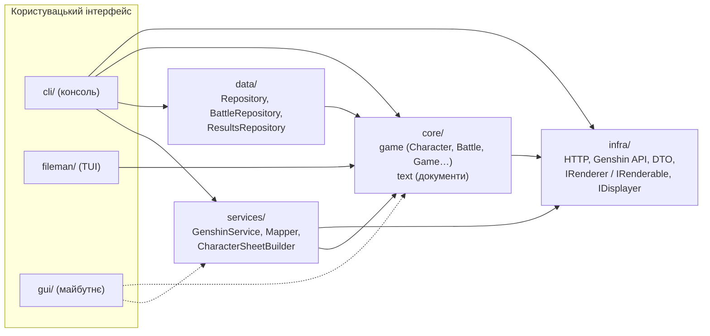
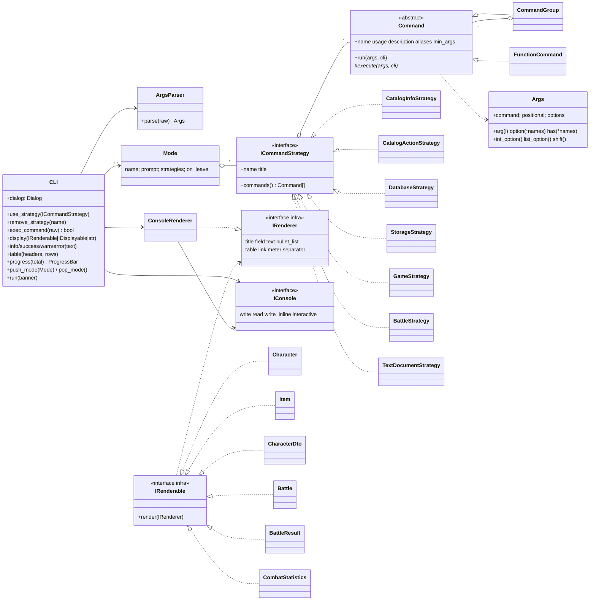
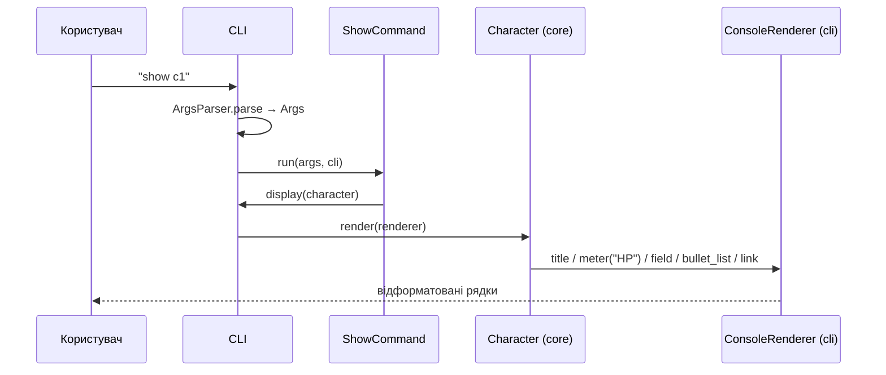
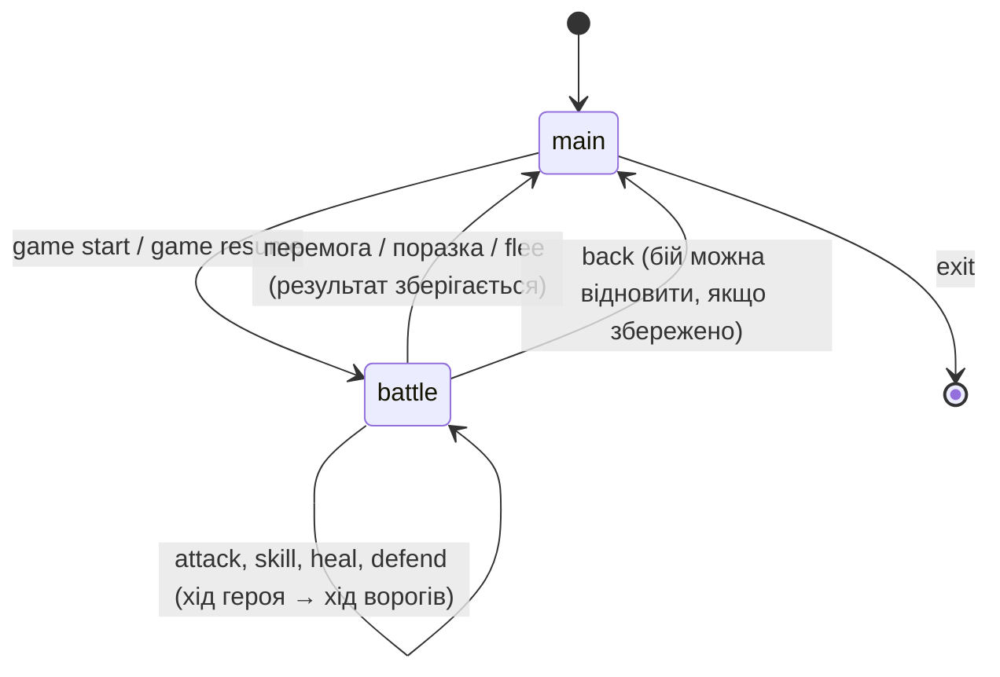

# Дизайн-документ: «Каталог персонажів і текстова гра»

| | |
|---|---|
| Автор | Хміленко М. |
| Версія | 1.3 (практичне заняття 13 — командний інтерфейс) |
| Мова / середовище | Python 3.10+, без сторонніх залежностей (pytest — лише для тестів) |
| Статус | CLI фіналізовано; графічний інтерфейс — наступні практичні |

## 1. Огляд

Додаток поєднує дві теми курсу:

* **Тема 1 — каталог персонажів.** Персонажі завантажуються з відкритої бази Genshin Impact
  (<https://genshin.jmp.blue>, або з локальних зразків у режимі `--offline`) чи створюються
  користувачем через діалог. Для кожного персонажа показується загальна інформація,
  характеристики, таланти, спорядження та **посилання на графіку** (іконка, картка, сплеш-арт).
* **Тема 2 — текстова гра.** Персонажі з каталогу формують команду й вирушають у покроковий бій
  проти інших персонажів (з каталогу або випадкових із бази). Стан бою можна зберегти й
  продовжити, результати накопичуються в історії.

Додатково в проєкті є текстовий редактор структурованих документів (режим `--text`,
попередні практичні) і консольний файловий менеджер FileMan (практичне 12, `files.py`).

### 1.1 Цілі

1. Єдиний розширюваний командний інтерфейс для всіх режимів.
2. Повна відокремленість логіки (core/services/data) від способу показу — щоб пізніше
   замінити консоль на GUI без змін у внутрішніх шарах.
3. Додавання нової команди / категорії команд без редагування фасаду CLI (Open/Closed).
4. Тестованість: увесь CLI проганяється в тестах через консоль у пам'яті.

### 1.2 Поза межами цієї версії

* Графічний інтерфейс (готується підґрунтя: `IRenderer`, `IConsole`).
* Завантаження зображень на диск — CLI показує лише посилання.
* Мережева гра, кілька гравців.

## 2. Архітектура

Шарувата архітектура; залежності спрямовані лише всередину (стрілка = «залежить від»):



| Пакет | Відповідальність |
|---|---|
| `core/game` | Персонажі, предмети, здібності, посередник `Game`, команди/undo, події, **`Battle`** (правила бою, ШІ ворогів, результат) |
| `core/text` | Структуровані документи (будівельник, фабрики форматів, прототипи, відвідувачі) |
| `infra` | HTTP-клієнти, клієнт API та DTO, **контракт представлення `IRenderer`/`IRenderable`** |
| `services` | Фасад над базою (`GenshinService` з кешем), перетворення DTO → об'єкти гри, лист персонажа |
| `data` | Збереження каталогу, документа, стану бою та історії результатів у JSON |
| `cli` | Консольний інтерфейс (цей документ, розділ 3) |
| `fileman` | Повноекранний файловий менеджер (практичне 12) |

### 2.1 Модель даних (основне)

* `CharacterData` — ім'я, HP/макс. HP, броня, атака, титул, стихія (vision), тип зброї, рідкісність,
  регіон, опис, `slug` у базі, **`images: dict[str, str]`** — посилання на графіку.
* `ItemData` — назва, бонуси до характеристик, тип зброї, рідкісність, опис, `images`.
* `BattleResult` — підсумок, кількість раундів, команда, вороги, ті, хто вижив, завдана/отримана шкода, час.

### 2.2 Файли, які створює додаток

| Файл (за замовчуванням) | Вміст | Команди |
|---|---|---|
| `saves/catalog.json` | Каталог користувача (персонажі, предмети, здібності) | `save`, `load`, `--load` |
| `saves/battle.json` | Незавершений бій (раунд, хто вже ходив, стан бійців, статистика) | `save` у бою, `game resume` |
| `saves/results.json` | Історія завершених боїв | `game results` |

Тека змінюється опцією `--saves DIR`.

## 3. Консольний інтерфейс (детально)

### 3.1 Запуск і вибір режиму

```
python3 main.py                              # діалог вибору режиму
python3 main.py --chars [--offline]          # каталог + гра (інтерактивно)
python3 main.py --text                       # редактор документів
python3 main.py --chars --offline db chars   # виконати одну команду й вийти
python3 main.py --chars --load saves/my.json --seed 42 --saves DIR
```

Аргументи розбирає `argparse` у `cli/app.py` (`parse_startup`). Усе, що стоїть після
опцій, — це одна команда CLI для неінтерактивного виконання (код виходу 0/1).
Без `--chars/--text` показується діалог вибору (`Dialog.choose`).
Під час виходу з інтерактивного режиму, якщо каталог змінено й не збережено,
CLI пропонує його зберегти.

### 3.2 Діаграма класів



### 3.3 Структура пакета `cli`

```
cli/
  framework/            ← повторно використовуваний каркас, нічого не знає про персонажів
    cli.py              CLI (фасад), Mode, CliDisplayer (адаптер до IDisplayer)
    args.py             Args, ArgsParser, CommandError, UsageError
    command.py          Command, FunctionCommand, CommandGroup
    strategy.py         ICommandStrategy, StaticStrategy
    graphic.py          CLIGraphic: IConsole/StdConsole/BufferConsole, Style, Notice, Level,
                        Table, Meter, ProgressBar, Dialog
    console_renderer.py ConsoleRenderer — реалізація IRenderer для консолі
  state.py              Catalog, CharactersContext — спільний стан стратегій
  strategies/
    catalog_info.py     CatalogInfoStrategy   (вивід)
    catalog_actions.py  CatalogActionStrategy (трансформативні дії)
    infrastructure.py   DatabaseStrategy, StorageStrategy (інфраструктурні дії)
    game.py             GameStrategy, BattleStrategy, BattleSession (текстова гра)
  text_cli.py           TextNavigator, TextDocumentStrategy (режим документів)
  app.py                точка складання: будує CLI і параметризує його стратегіями
```

### 3.4 Фасад `CLI`

Зовнішній код спілкується з консоллю лише через `CLI`:

* **`use_strategy(strategy)`** — додає категорію команд у поточний режим. Конфлікт імен
  (включно з псевдонімами) одразу дає `ValueError` — помилка конфігурації, а не користувача.
* **`exec_command(raw)`** — `ArgsParser.parse` → пошук команди серед стратегій поточного режиму
  та вбудованих (`help`, `back`, `exit`) → `Command.run`. Усі очікувані помилки
  (`CommandError`, `UsageError`, `ValueError`, `OSError`, `RemoteServiceError`) перехоплюються тут
  і показуються як `✗ повідомлення`; для `UsageError` додається рядок `usage: …`.
  Повертає `True/False` (використовується для коду виходу в неінтерактивному запуску).
* **`display(obj)`** — показує `IRenderable` (через `ConsoleRenderer`), `IDisplayable` (рядок) чи текст.
* **`info / success / warn / error`** — стилізовані повідомлення (`·`, `✓`, `!`, `✗`; кольори лише в терміналі
  і якщо не задано `NO_COLOR`).
* **`table`, `progress`, `dialog`** — доступ до елементів CLIGraphic.
* **`as_displayer()`** — адаптер `IDisplayer`, щоб події ядра (`Game` → `DisplayObserver`) теж ішли через CLI.

### 3.5 Стратегії команд

Фасад параметризується стратегіями; кожна — окрема категорія з розділу практичного.

| Стратегія | Категорія | Команди |
|---|---|---|
| `CatalogInfoStrategy` | Вивід інформації | `ls [char\|item\|ability] [--filter t]`, `show <id\|ім'я>`, `sheet <id> [--toc] [--format plain\|markdown\|html]`, `stats` |
| `CatalogActionStrategy` | Трансформативні дії | `create <char\|item\|ability>` (діалог), `add <char> <item\|ability>` (псевдоніми `equip`, `teach`), `act <attack\|heal\|ability> <актор> <ціль> [--id a1]`, `undo`, `rm <id> [--yes]` |
| `DatabaseStrategy` | Інфраструктурні дії | `db refresh [--weapons]`, `db chars [--filter]`, `db weapons [--filter]`, `db show <char\|weapon> <slug>`, `db create <slug>`, `db equip <char> <weapon_slug>` |
| `StorageStrategy` | Інфраструктурні дії | `save [path]`, `load [path]` |
| `GameStrategy` | Гра (головний режим) | `game roster`, `game start [--team c1,c2] [--enemies c3\|random] [--count n]`, `game resume [path]`, `game results [--last n]` |
| `BattleStrategy` | Гра (режим бою) | `status`, `attack [ворог#]`, `skill <№\|назва> [ворог#]`, `heal [союзник#]`, `defend`, `flee`, `save [path]` |
| вбудовані | Загальні | `help [команда]`, `back`, `exit` |
| `TextDocumentStrategy` | Режим `--text` | `pwd`, `print`, `cp`, `template`, `add`, `rm`, `up`, `cd`, `save`, `load` |

Як вимоги ТЗ покриваються командами:

| Вимога | Як виконано |
|---|---|
| Оновлювати й виводити список усіх персонажів | `db refresh` (скидає кеш, завантажує всіх з прогрес-баром) → `db chars` (таблиця); `ls` — каталог користувача |
| Загальна інформація + посилання на графіку | `show <id>`, `db show char <slug>` — характеристики, опис, таланти, посилання `icon-big`, `card`, `gacha-splash`; для своїх персонажів — посилання/шлях, введений у діалозі |
| Створювати персонажа через діалог | `create char` — валідація, значення за замовчуванням, повторні запитання, перевірка унікальності імені |
| Зберігати дані користувача | `save`/`load`, `--load`, пропозиція зберегти при виході |
| Вибір персонажів для гри | `game roster`, `game start` (через опції або діалог), випадкові вороги з бази |
| Почати гру, дії в основному циклі | режим `battle>`: `attack`, `skill`, `heal`, `defend`, `flee`, `status` |
| Зберігати стан і результати | `save` у бою + `game resume`; результати → `saves/results.json`, `game results` |

### 3.6 Моделі компонента

* **`Command`** — інкапсулює одну команду замість «голої» лямбди: ім'я, псевдоніми, рядок використання,
  опис, мінімальну кількість аргументів. `run()` — шаблонний метод (перевірка → `execute()`).
  Більшість команд — окремі класи з залежностями, переданими в конструктор.
  `FunctionCommand` — адаптер для простих випадків (вбудовані команди, текстовий режим, FileMan).
  `CommandGroup` — компонувальник для підкоманд (`db …`, `game …`); без підкоманди показує їх таблицею.
* **`Args`** — об'єктне представлення розібраного рядка: `command`, `positional`, `options`
  і зручні методи (`arg`, `option` з псевдонімами, `has`, `int_option`, `list_option`, `shift`).
* **`ArgsParser`** — граматика:
  `команда арг "арг з пробілами" --ключ значення -k значення --прапорець --ключ=значення`.
  Опція, за якою йде інша опція чи кінець рядка, — прапорець із порожнім значенням.
  `-5` залишається позиційним аргументом (від'ємне число).
* **CLIGraphic** (`graphic.py`): `IConsole` (`StdConsole` — термінал, `BufferConsole` — пам'ять для тестів/GUI),
  `Style` (ANSI), `Notice`/`Level`, `Table` (вирівнювання, обрізання довгих клітинок),
  `Meter` (шкала HP з кольором), `ProgressBar` (у терміналі перемальовує рядок,
  у неінтерактивному виводі друкує лише підсумок), `Dialog` (`ask`, `ask_int`, `choose`, `confirm`
  з валідацією, повтором до 3 разів і скасуванням по EOF).

### 3.7 Представлення даних: `IRenderable` + `IRenderer`

З двох варіантів із практичного обрано **другий**: інтерфейси `IRenderer` і `IRenderable`
оголошені у внутрішній бібліотеці (`infra/rendering.py`), а CLI лише **реалізує** `IRenderer`
(`ConsoleRenderer`).



Чому так:

* напрямок залежності правильний — ядро не імпортує нічого з `cli`;
* клас сам знає, *з чого* він складається (заголовок, поля, таблиця, посилання),
  а інтерфейс вирішує, *як* це показати — інкапсуляція не порушується;
* для GUI достатньо написати `WidgetRenderer(IRenderer)` — `Character.render` не зміниться.

Ціна рішення — внутрішні класи мусять реалізувати `render()`; набір будівельних блоків
`IRenderer` навмисно малий і загальний (8 методів).

### 3.8 Режими (State): головний режим і бій

`CLI` тримає стек `Mode`. Кожен режим — набір стратегій і власний промпт.
`game start`/`game resume` додають режим `battle` з однією `BattleStrategy`,
тож під час бою команди каталогу недоступні, а `help` показує лише дії бою.



`BattleSession` пов'язує `Battle` (ядро) з CLI: після кожної дії друкує стан, а коли бій
завершено — показує `BattleResult`, додає його до `ResultsRepository` і виходить з режиму.
Помилкова дія (неіснуюча ціль, лікування з повним HP) хід **не** витрачає.

Правила бою (ядро, `core/game/battle.py`): раунд = кожен живий герой діє один раз, далі діють усі
живі вороги (`EnemyAI`: б'є найслабшого героя, з імовірністю 35% — здібністю). `defend` зменшує
отриману шкоду вдвічі до наступного раунду. Бійці — клони персонажів каталогу,
тож програний бій не «псує» каталог. Усі дії проходять через `Game` (посередник + команди + спостерігачі).

### 3.9 Обробка помилок

| Ситуація | Поведінка |
|---|---|
| Невідома команда / підкоманда | `✗ Unknown command…` + перелік підкоманд групи |
| Замало аргументів, некоректна опція | `✗ …` + `usage: …` |
| Неправильне значення в діалозі | `! must be at least 1` і повторне запитання (до 3 разів) |
| Кінець вводу посеред діалогу | `✗ Input cancelled.`, стан не змінюється |
| Помилка мережі / 404 в API | `✗ 404 … / Network error …`; `db refresh` пропускає проблемні записи і показує їх списком |
| Відсутній файл збереження | `✗ No such file: …` |

### 3.10 Як розширювати

Нова команда:

```python
class HealAllCommand(Command):
    name, usage, description = "healall", "", "restore HP of every character"

    def __init__(self, ctx: CharactersContext) -> None:
        self._ctx = ctx

    def execute(self, args: Args, cli: CLI) -> None:
        for c in self._ctx.catalog.unique_characters():
            c.heal(c.max_health)
        cli.success("Everyone is healthy again.")
```

Нова категорія — клас `ICommandStrategy`, що повертає свої команди, і один рядок у `app.py`:
`cli.use_strategy(MyStrategy(ctx))`. Фасад `CLI` при цьому не змінюється.

## 4. Тестування

* `pytest` — 327 тестів; CLI тестується наскрізно через `BufferConsole` (скриптовані відповіді
  діалогам, перевірка виводу конкретної команди) і офлайн-клієнт API (`FileHttpClient`).
* `tests/test_cli.py` — парсер, `Args`, фасад, групи, режими, віджети, діалоги, команди каталогу.
* `tests/test_remote_cli.py` — `db …`, посилання на графіку, `sheet`, збереження персонажів із бази.
* `tests/test_game_cli.py` — правила бою, збереження бою, історія результатів, повний цикл гри через CLI.
* `usage/*_session.txt` + `*_output.txt` — записані демонстраційні сесії
  (`python3 main.py --chars --offline --seed 13 < usage/catalog_session.txt`).

## 5. Відомі обмеження й подальші кроки

* Публічне API `genshin.jmp.blue` періодично недоступне (під час написання повертало HTTP 521) —
  для роботи та тестів є `--offline` зі зразками в `samples/genshin`.
* Текстовий режим (`--text`) використовує старі функції команд через адаптер `FunctionCommand`
  і друкує напряму в stdout; при переході на GUI їх варто перевести на `cli.display`.
* Наступний крок — GUI: реалізація `IRenderer` і `IConsole` для вікна, повторне використання всіх стратегій.
